# SimDiff — 시뮬레이터가 어디서 틀리는지 찾는 연구

- **1단계**: 진자 재현성 감사 (288개 조건)
- **2단계**: 2링크 팔(혼돈), 미끄러지는 상자(접촉), Sobol 민감도 분석, 뒤집힘 지수 (약 6만 2천 회 실행)
- **3단계**: 퍼징으로 규칙의 반례 찾기 → 원인 규명 → 규칙 보완 (11만 5천 회 평가), 불일치 지도

모든 결과는 새 환경에서 다시 돌려 CSV가 바이트 단위로 같게 나오는 것을 확인했다.

## 한눈에 보는 결론

1. **기본 설정이 타임스텝보다 무섭다.** PyBullet 기본값(링크 감쇠, 관성 무시, 마찰 곱셈 결합)만으로 오차가 수십~수백 % 생긴다.
2. **엔진끼리 합의해도 정답이 아니다.** 진자에서는 소수점 14자리까지, 혼돈하는 2링크 팔에서는 17초 동안 두 엔진이 일치했지만 정답과는 1.3초 만에 갈라졌다.
3. **접촉 오차는 설정 하나가 아니라 '멈출 때까지 몇 스텝인가'라는 무차원 수가 좌우한다.** 300스텝 이상이면 98% 이상이 오차 1% 미만.
4. **"어느 엔진이 더 정확한가"는 설정에 따라 뒤집힌다.** 뒤집힘 지수 0.52 — 사실상 동전 던지기.
5. **300스텝 규칙에도 반례가 있다.** 퍼징이 찾은 최악 오차 26%. 원인(넘어짐 여유, 접촉 반응 시간, PyBullet의 큰 dt·ERP)을 규칙에 추가하자 최악 오차가 2%로 줄었다.
6. **정답 없이 오차를 추정하려면 다른 엔진이 아니라 타임스텝을 반으로 줄여 비교하라.** 자기 불일치 x 2는 실제 오차를 거의 그대로 맞히지만(2링크 팔 순위상관 0.999), 엔진 간 불일치는 2링크 팔에서 오차 크기를 10¹³배(중앙값) 과소평가한다.

## 실행 방법

```bash
pip install mujoco pybullet scipy matplotlib pyyaml pandas SALib
python run_pendulum.py && python analyze.py         # 1단계 (약 20초)
python run_arm.py                                   # 2단계-A 2링크 팔 (약 1.5분)
python run_box.py                                   # 2단계-B 상자 함정·격자 (수 초)
python run_sobol.py 2048                            # 2단계-C Sobol (2코어 약 9분, 빠르게 보려면 N=256)
python analyze_stage2.py                            # 2단계 요약·그래프
python fuzz.py 600 8 --rules v1                     # 3단계 퍼징 (규칙 버전마다 2코어 약 6분)
python fuzz.py 600 8 --rules v1_mu
python fuzz.py 600 8 --rules v2
python fuzz.py 600 8 --rules v3
python scan_contact.py                              # 넘어짐 여유 격자 (약 30초)
python pb_chaos.py                                  # PyBullet 입력 민감도
python failure_tree.py                              # 실패 원인 의사결정나무
python disagreement_map.py                          # 불일치 지도 (약 1분)
python analyze_stage3.py                            # 3단계 요약·그래프
```

실험 조건은 `experiments/*.yaml`과 각 스크립트 상단에 있다.

---

# 1단계: 진자 재현성 감사

같은 진자를 MuJoCo와 PyBullet에 똑같이 만들고, 고정밀 ODE 기준 해(사실상 정답)와 비교했다.
타임스텝, 적분기, 엔진 기본 설정, 초기 각도, 관절 감쇠를 바꿔 가며 총 288개 조건을 돌렸다.

## 실험 설계

| 항목 | 값 |
|---|---|
| 모델 | 질량 1 kg, 힌지~질량중심 0.5 m, 질량중심 관성 0.002 kg·m² |
| 기준 해 | scipy DOP853, 허용오차 1e-12 |
| 시간 | 10초 |
| 초기 각도 | 30°, 90°, 170° |
| 관절 감쇠 | 0, 0.05 N·m·s/rad |
| 타임스텝 | 0.5, 1, 2, 5, 10, 20 ms |
| MuJoCo | Euler(기본값), RK4, implicit, implicitfast |
| PyBullet | clean(모든 기본값 교정), 관성만 수정, 감쇠만 수정, 기본값 그대로 |
| 지표 | 각도 RMSE, 최대 오차, 기준 해 대비 에너지 오차 |
| 결정성 | 모든 조건을 2번씩 돌려 비트 단위로 같은지 확인 |

## 결과

### 발견 1. 타임스텝보다 기본 설정이 훨씬 큰 오차를 만든다

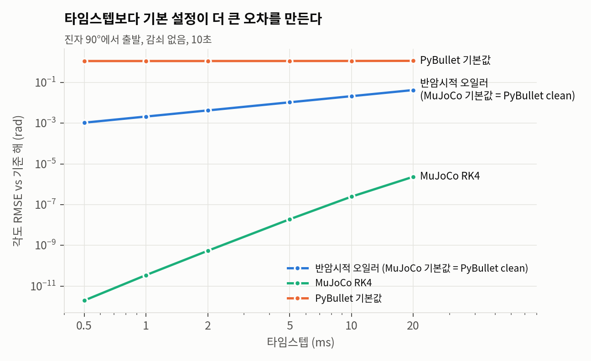

- PyBullet을 URDF 그대로 불러오면 오차가 약 1.1 rad (약 64°)로, 타임스텝을 아무리 줄여도 안 줄어든다.
- 원인은 두 가지 기본값이다.
  - **링크 감쇠**: PyBullet은 모든 링크에 기본 감쇠(0.04)를 건다. 감쇠가 없어야 할 진자가 10초 만에 에너지의 68%를 잃는다 (그림 2).
  - **관성 무시**: `URDF_USE_INERTIA_FROM_FILE` 플래그 없이 불러오면 URDF에 적힌 관성(0.002)을 무시하고 6.7×10⁻⁷ 로 바꿔 버린다. 이것만으로도 10초 뒤 RMSE 0.1 rad.
- 반암시적 오일러(MuJoCo 기본값, 교정한 PyBullet)의 오차는 타임스텝에 정확히 비례한다 (기울기 1.00). RK4는 기울기 3.8로 4차 정확도에 가깝다. 이론과 맞으므로 측정 파이프라인 자체는 믿을 수 있다.

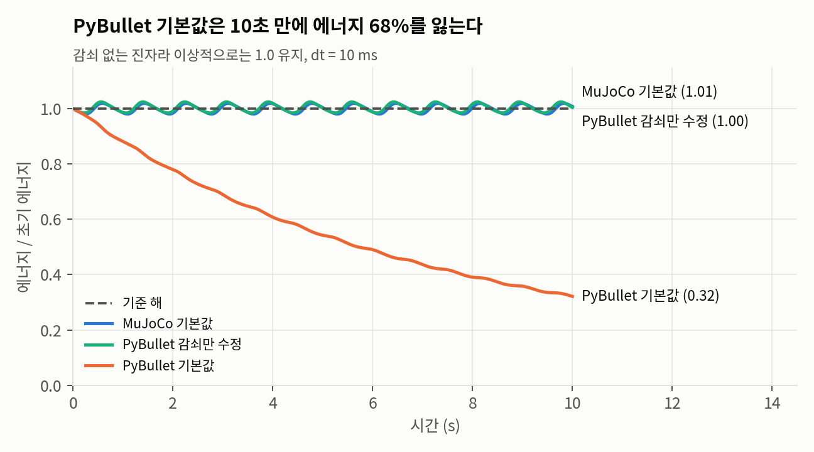

### 발견 2. 두 엔진이 완벽히 합의해도 둘 다 틀릴 수 있다 (3단계 가설에 대한 첫 반례)

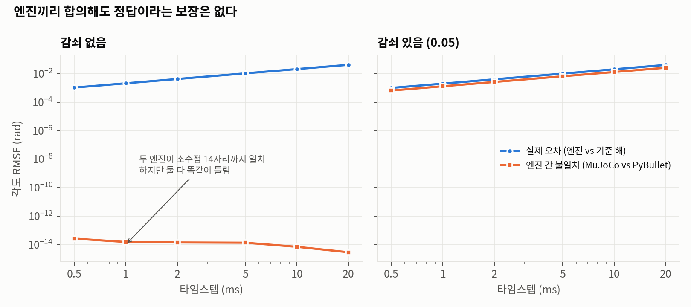

- 감쇠가 없을 때 MuJoCo와 교정된 PyBullet은 **소수점 13~16자리까지 똑같은 궤적**을 낸다. 같은 적분 방식(반암시적 오일러)을 쓰기 때문이다.
- 그런데 둘 다 기준 해와는 최대 0.042 rad 차이 난다. 엔진 불일치는 0인데 오차는 0이 아니다.
- 즉 **"엔진끼리 결과가 같으면 믿을 만하다"는 가정은 엔진들이 같은 근사를 공유하면 깨진다.** 불일치 지도를 만들 때는 서로 다른 적분 방식을 섞어야 한다.
- 감쇠를 넣으면 두 엔진이 갈라지고 (PyBullet 오차가 평균 2.1배), 이때는 불일치와 오차의 순위상관이 0.998로 매우 높다. 단, 둘 다 타임스텝에 비례해서 커지는 효과가 섞여 있어서, 같은 타임스텝 안에서도 상관이 유지되는지는 다음 단계에서 따로 확인해야 한다.

### 발견 3. 그 밖의 확인 사항

- MuJoCo의 Euler, implicit, implicitfast는 이 진자에서 모든 조건에서 결과가 같았다. MuJoCo의 Euler는 관절 감쇠를 원래 암시적으로 처리하므로, 속도에 따라 변하는 힘이 관절 감쇠뿐인 이 모델에서는 차이가 없는 것이 자연스럽다.
- 288개 조건 모두 반복 실행 시 비트 단위로 같았다 (결정적).

## 한계

- 기준 해는 이상적인 수학 모델이지 실물이 아니다. 실물과의 차이는 3단계에서 다룬다.
- 진자는 접촉이 없어서 솔버 반복 횟수나 랜덤 시드의 영향이 드러나지 않는다. 이 변수들은 상자 밀기, 공 튕기기 같은 접촉 장면에서 검증해야 한다.
- 감쇠 조건의 높은 상관은 타임스텝이라는 공통 원인에 의한 것일 수 있다.

---

# 2단계-A: 2링크 팔 — 혼돈 속에서 예측 가능 시간

균일 막대 두 개로 된 2링크 팔(이중 물리진자)을 기준 해, MuJoCo, PyBullet에 똑같이 만들었다.
큰 진폭에서는 혼돈 운동이라 아주 작은 오차도 지수적으로 불어난다.
**예측 가능 시간** = 관절각 오차가 0.1 rad를 처음 넘는 시각으로 정의했다.

- 초기 자세 15개: 지정 3개(작은·중간·큰 진폭) + 무작위 12개(시드 0 고정). 기준 해 검증에서 혼돈으로 확인된 12개로 중앙값을 내고, 나머지 3개는 비혼돈 대조군으로 따로 봤다.
- 타임스텝 0.25~5 ms, MuJoCo Euler / implicitfast / RK4, PyBullet clean, 각 20초
- 기준 해 검증: 허용오차 1e-12 해와 1e-10 해가 1e-3 rad 이상 벌어지기 전까지만 기준 해를 믿는다. 이 시간을 넘는 예측 가능 시간은 "그 이상"으로만 보고한다(하한값).
- 나비효과 한계: 기준 해의 초기각을 1e-9 rad만 바꿨을 때의 예측 가능 시간. 물리 자체가 허락하는 한계다.
- 기준 해는 MuJoCo RK4와 3초까지 1e-12 rad 이내로 일치해서 운동방정식 유도를 교차 검증했다.

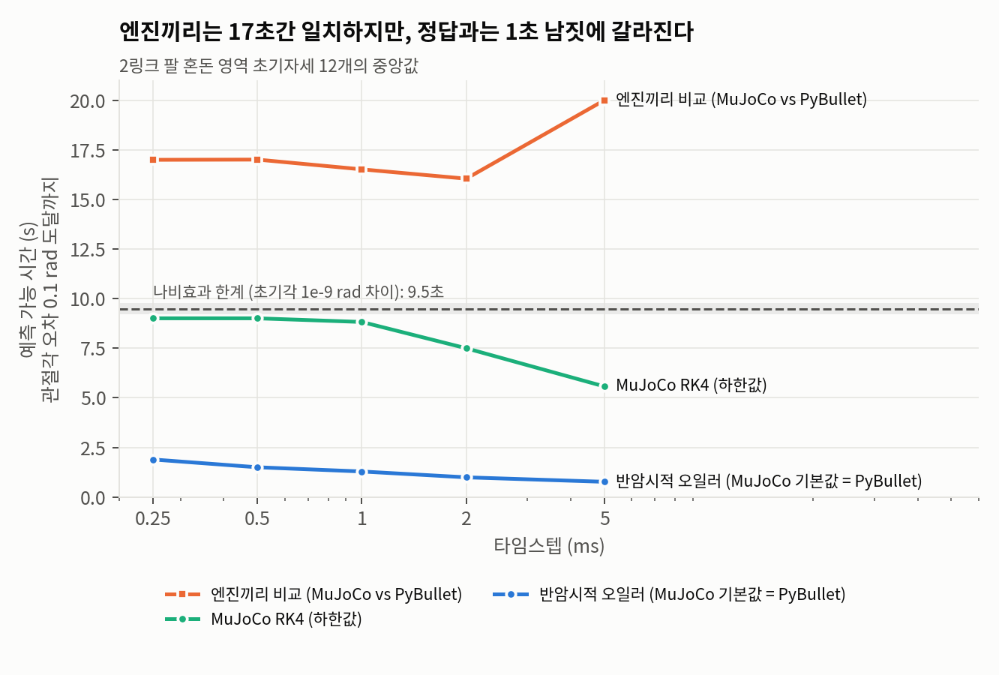

| 혼돈 초기자세 12개 중앙값 | 0.25 ms | 1 ms | 5 ms |
|---|---|---|---|
| 반암시적 오일러 (MuJoCo 기본값 = PyBullet) | 1.89초 | 1.29초 | 0.77초 |
| MuJoCo RK4 | ≥ 9.0초 | ≥ 8.8초 | 5.6초 |
| 엔진끼리 비교 | 17.0초 | 16.5초 | 20초 내내 일치 |
| 나비효과 한계 | 9.5초 | | |

**발견**
- 두 엔진은 약 17초 동안 서로 일치하지만, 정답과는 1.3초 만에 갈라진다. 1단계의 "합의 ≠ 정확" 현상이 혼돈계에서 **13배** 규모로 재현됐다.
- 반암시적 오일러는 타임스텝을 10배 줄여도 예측 가능 시간이 **약 0.85초** 늘어날 뿐이다. 혼돈계에서는 오차가 지수적으로 커지기 때문에 예측 시간이 타임스텝의 로그에만 비례한다.
- RK4는 작은 타임스텝에서 나비효과 한계(9.5초)에 거의 도달한다. 이 이상은 어떤 시뮬레이터로도 불가능하다. 즉 "시뮬레이터 탓인 오차"와 "물리 자체의 한계"를 분리할 수 있다.
- 비혼돈 대조군 중 작은 진폭(10°, 5°)은 모든 설정이 20초 내내 정답과 일치했다. 중간 진폭 2개는 RK4만 끝까지 맞았고, 반암시적 오일러는 위상이 조금씩 밀려 0.8~8.6초에 0.1 rad를 넘었다. 이때도 두 엔진끼리는 끝까지 일치했다.

---

# 2단계-B: 미끄러지는 상자 — 접촉과 마찰

바닥 위 상자(10 cm 정육면체, 1 kg)에 수평 속도 v0를 주면 마찰로 멈춘다.
해석해가 있어서 정답이 명확하다: **정지 거리 = v0² / (2 μ g)**. 모든 실행에서 상자는 넘어지지 않았다.

### 발견 1. 마찰 입력 방식 하나로 오차 66~262%

| 설정 (dt = 2 ms, 물리 조건 9개) | 평균 오차 | 범위 |
|---|---|---|
| MuJoCo 기본값 | -0.34% | -0.63 ~ -0.02% |
| PyBullet 올바른 설정 | -0.40% | -0.98 ~ -0.12% |
| PyBullet 기본 링크 감쇠 유지 | -4.6% | -11.5 ~ -1.8% |
| **PyBullet 마찰을 바닥·상자 모두 μ로 입력** | **+136%** | **+66 ~ +262%** |

- MuJoCo는 두 물체의 마찰 중 큰 값을 쓰지만 PyBullet은 **곱한다**. 그래서 MuJoCo처럼 양쪽에 μ를 적으면 실제 마찰은 μ²가 된다.
- 측정 시간 안에 상자가 멈춘 경우(μ = 0.6 전부, μ = 0.4·v0 = 1)는 μ² 이론값(+67%, +150%)과 1%p 이내로 맞았다. 나머지는 마찰이 너무 약해져 측정 시간(정상 정지 시간 + 0.7초) 안에 멈추지도 않았으므로, 실제 오차는 표의 값보다 더 크다.

---

# 2단계-C: Sobol 민감도 분석과 뒤집힘 지수

물리 조건(μ, v0)과 엔진 설정을 한꺼번에 넣고 정지 거리 |오차|의 분산을 분해했다.
Saltelli 표본 N = 2048 → MuJoCo 32,768회, PyBullet 28,672회. 범주형 설정(마찰 원뿔 종류, 적분기)은 [0,1] 값을 반으로 나눠 대응시켰다.

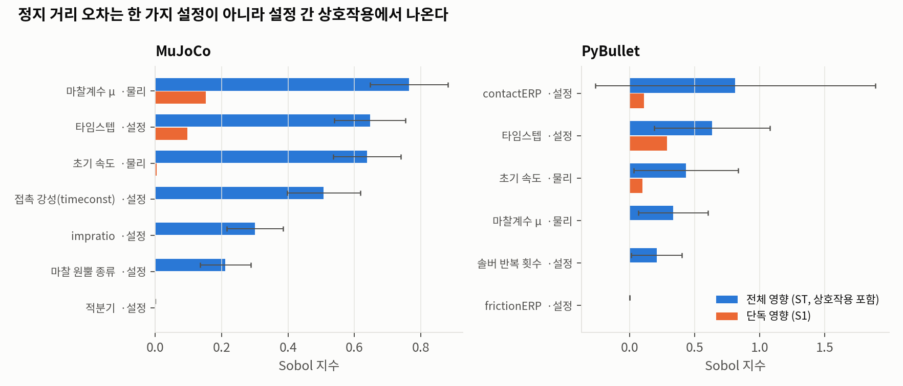

- **단독 영향(S1)의 합은 MuJoCo 0.25, PyBullet 0.50** 뿐이다. 나머지는 설정끼리의 상호작용이다. "타임스텝만 줄이면 된다" 같은 한 줄짜리 처방이 통하지 않는다는 뜻이다.
- **적분기(MuJoCo)와 frictionERP(PyBullet)는 영향이 0**이다. 이 장면에서는 안 건드려도 되는 설정이다.
- PyBullet은 오차 분포 꼬리가 길어서(최대 82%, contactERP가 크고 dt가 10 ms에 가까울 때) 신뢰구간이 넓다. PyBullet 순위는 참고용이다.

### 상호작용의 정체: 정지까지 걸리는 스텝 수

μ, v0, dt를 묶은 무차원 수 **v0 / (μ g Δt)** (= 상자가 멈출 때까지 몇 스텝인가) 하나가
log|오차| 분산의 **68% (MuJoCo), 48% (PyBullet)**를 설명한다. 단독 영향 합보다 훨씬 크다.

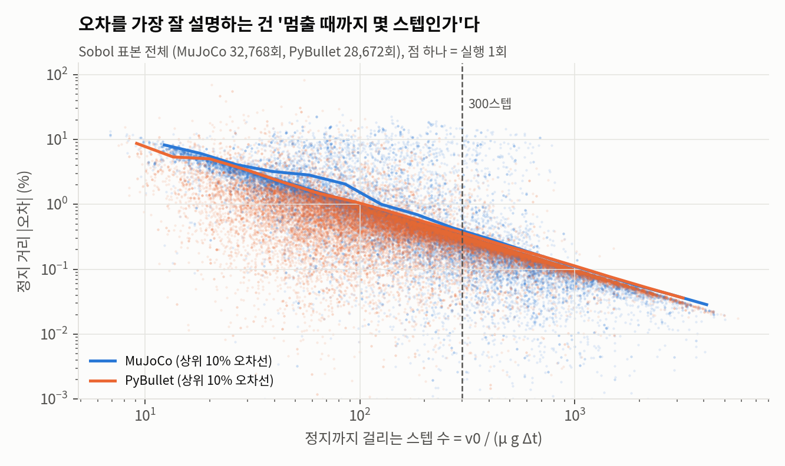

| 정지까지 스텝 수 | ~20 | 20~50 | 50~100 | 100~300 | 300~ |
|---|---|---|---|---|---|
| MuJoCo 평균 |오차| | 5.5% | 2.7% | 1.7% | 0.84% | 0.26% |
| MuJoCo 오차 1% 미만 비율 | 2% | 7% | 26% | 92% | 98% |
| PyBullet 평균 |오차| | 3.1% | 1.7% | 0.96% | 0.51% | 0.17% |
| PyBullet 오차 1% 미만 비율 | 21% | 46% | 73% | 96% | 99.5% |

**실용 규칙**: 접촉 이벤트(멈춤, 충돌 등)가 최소 300스텝 이상에 걸쳐 일어나도록 타임스텝을 잡으면 두 엔진 모두 98% 이상 오차 1% 미만이다.

### 뒤집힘 지수 (Flip Index)

"MuJoCo와 PyBullet 중 어느 쪽이 더 정확한가?"라는 결론이 설정에 따라 얼마나 뒤집히는지 재는 지표를 정의했다.

> **뒤집힘 지수** = 같은 물리 조건에서, 기본 설정(dt 2 ms)일 때 이긴 엔진의 반대 엔진이 다른 설정에서 이기는 비율.
> 두 엔진 |오차| 차이가 0.05%p 이내면 무승부로 보고 제외한다.

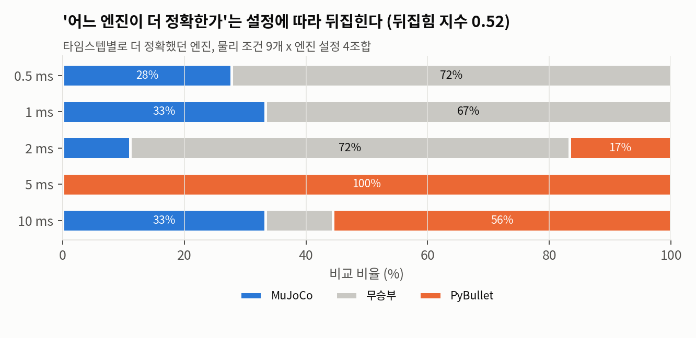

- **뒤집힘 지수 = 0.52** (승부가 난 54쌍 중 28쌍). 결론이 사실상 동전 던지기다.
- 작은 타임스텝(≤ 1 ms)에서는 MuJoCo가 이기거나 비기고, 5 ms에서는 PyBullet이 36전 36승, 10 ms에서는 다시 섞인다.
- 즉 "엔진 A가 B보다 정확하다"는 주장은 **어떤 설정에서 비교했는지 없이는 의미가 없다.**

## 2단계 한계

- 기준은 이상적인 수학 모델(해석해, 고정밀 ODE)이다. 실물과의 비교는 3단계 과제다.
- 상자 장면은 넘어짐, 회전, 여러 점 접촉이 없는 가장 단순한 접촉이다. 공 튕기기(반발), 잡기(다점 접촉)로 확장해야 일반화할 수 있다.
- 뒤집힘 지수는 물리 조건 9개 x 설정 20조합의 작은 격자에서 계산했다. 무승부 기준(0.05%p)에 따라 값이 달라질 수 있어 기준을 함께 보고했다.
- PyBullet Sobol 지수는 꼬리가 긴 분포 때문에 신뢰구간이 넓다. log 오차나 순위 기반 지표로 다시 계산하면 더 안정적일 것이다.

---

# 3단계-A: 퍼징 — 규칙의 반례를 찾고, 원인을 밝히고, 규칙을 고친다

2단계의 실용 규칙("정지까지 300스텝 이상이면 오차 1% 미만")은 무작위 표본 98%에서 성립했다.
하지만 무작위 표본은 드물게 나타나는 최악의 경우를 놓친다.
그래서 **규칙을 지키는 조건만 골라서 오차를 최대화하는 탐색(퍼징)**을 돌렸다.

- 탐색 대상: MuJoCo 오차, PyBullet 오차, 두 엔진의 차이 (상자 장면)
- 탐색기: CMA-ES(진화 전략)와 무작위 탐색, 각 시드 8개 x 600회
- 규칙 강제: 모든 후보를 규칙 안으로 잘라 넣는다 (예: dt = min(샘플한 dt, 정지시간/300))
- 찾은 최악 조건마다 주변을 ±2% 흔들어 40번 재평가해서, 칼날 위 한 점인지 넓은 영역인지 확인

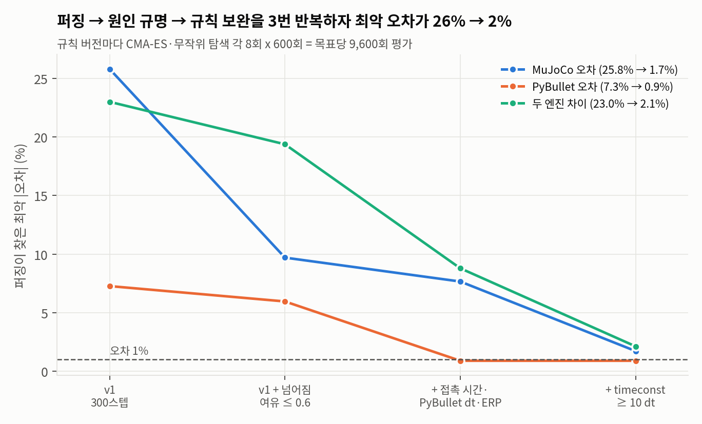

### 반복 1: 300스텝 규칙 (v1) → 최악 26%

| 목표 | 최악 오차 | 찾은 탐색기 | 주변 40점 중앙값 |
|---|---|---|---|
| MuJoCo | 25.8% | CMA-ES | 0.97% |
| PyBullet | 7.3% | 무작위 | 0.51% |
| 두 엔진 차이 | 23.0% | CMA-ES | 0.73% |

**원인 1: 이론상 넘어지지 않을 상자가 넘어진다.** MuJoCo 최악 조건(μ 0.79, 딱딱한 접촉, impratio 4.6, elliptic 원뿔)을 시간순으로 보니, 상자가 튀어 오른 뒤 앞으로 굴러 넘어졌다.
하나씩 기본값으로 되돌려 보면 timeconst를 0.02로, impratio를 1로, μ를 0.4로 바꾸거나 dt를 1/4로 줄이는 것 중 **어느 하나만 해도** 오차가 0.2% 이하로 떨어진다. 2단계 Sobol 분석에서 본 "상호작용"의 실체다.

강체 쿨롱 마찰 이론에서 상자는 **넘어짐 여유 τ = μ · (높이/2) / (바닥 폭/2)** 가 1 이상일 때만 넘어진다.
상자 높이 3종 x μ 14단계로 1,134번 돌려 보니:

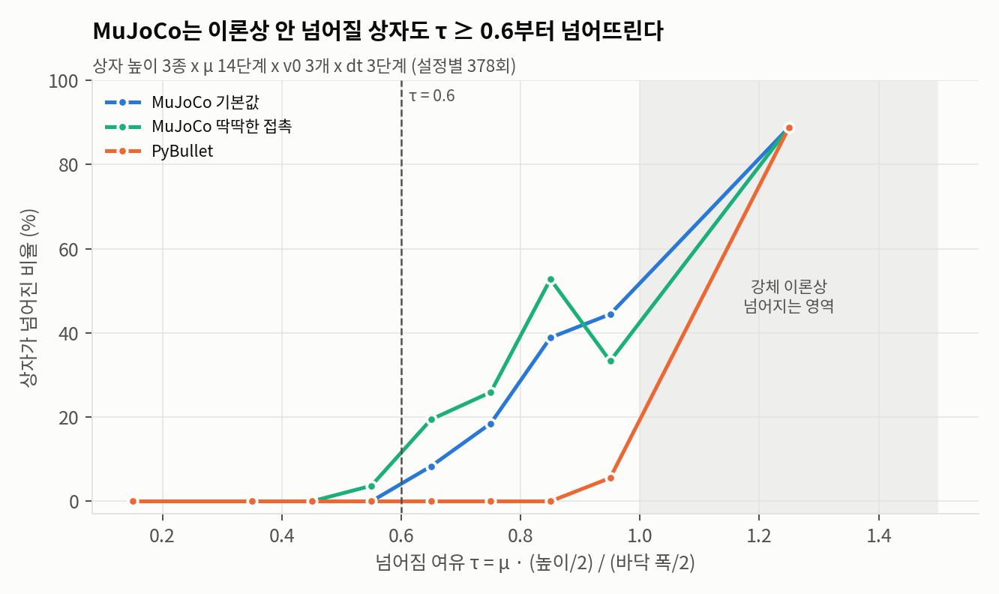

- PyBullet은 τ < 0.9 에서 한 번도 넘어지지 않았다 (이론과 일치).
- MuJoCo는 **τ가 0.6을 넘으면 넘어지기 시작**해서, τ 0.8~0.9 에서는 39~53%가 넘어졌다. τ < 1 구간의 정지 거리 오차는 최대 30%.
- 상자 모양이 달라도(납작, 정육면체, 길쭉) τ 하나로 정리됐다. 길쭉한 상자(높이/폭 1.5)는 μ 0.4부터 넘어졌다.
- τ ≥ 1 에서는 세 설정 모두 89%가 넘어졌다. 이론상 넘어지는 영역이라, 넘어짐 판정 자체가 올바르다는 확인도 된다.

### 반복 2: + 넘어짐 여유 ≤ 0.6 (v1_mu) → 최악 19%

| 목표 | 최악 오차 | 원인 |
|---|---|---|
| MuJoCo | 9.7% | 정지까지 0.085초인데 접촉 반응 시간(timeconst)이 0.05초 — 사건이 끝나기 전에 마찰이 다 걸리지 않음 |
| PyBullet | 6.0% | 큰 dt(9.5 ms) + 큰 contactERP(0.72) + 낮은 μ |
| 두 엔진 차이 | 19.4% | PyBullet 쪽 원인과 같음 |

이번에는 주변 40점도 모두 1%를 넘었다. 칼날 위 한 점이 아니라 **넓은 실패 영역**이다.
2단계 Sobol 표본에 의사결정나무(깊이 3, `failure_tree.py`)를 학습시켜 봤더니, 퍼징과 독립적으로 같은 종류의 변수를 분기 기준으로 골랐다. 가장 중요한 건 역시 정지까지 스텝 수(중요도 80~86%)였고, 그다음이 넘어짐 여유, timeconst와 dt·정지시간의 비율(MuJoCo), 절대 dt와 contactERP(PyBullet)였다 (교차검증 정확도 MuJoCo 93%, PyBullet 89%. 아무것도 안 보고 전부 '성공'으로 찍으면 70%, 86%라서 PyBullet 쪽 개선 폭은 작다).

### 반복 3: + 접촉 시간·PyBullet 조건 (v2) → 최악 9%

추가한 규칙: MuJoCo timeconst ≤ 0.2 x 정지시간, PyBullet dt ≤ 5 ms, contactERP ≤ 0.6.
PyBullet은 여기서 최악 0.9%로 **규칙이 성립**했다 (9,600회 중 1% 초과 0회).
MuJoCo는 여전히 7.7% — timeconst가 dt의 3.4배밖에 안 되는 아주 딱딱한 접촉 + impratio 7.3.

### 반복 4: + timeconst ≥ 10 x dt (v3) → 최악 2%

| 목표 | 최악 오차 | 1% 넘는 평가 비율 (CMA-ES / 무작위) |
|---|---|---|
| MuJoCo | 1.7% | 5.1% / 0.21% |
| PyBullet | 0.9% | 0% / 0% |
| 두 엔진 차이 | 2.1% | 36.6% / 1.1% |

남은 최악 조건은 모든 규칙의 경계(τ = 0.6, 정지까지 정확히 300스텝, timeconst = 0.2 x 정지시간)에 붙어 있다.
경계에서 조금 안쪽으로 여유를 두면 1% 안에 들어올 것으로 보인다.

**최종 규칙 (상자처럼 미끄러지다 멈추는 접촉 사건)**

| | 조건 |
|---|---|
| 공통 | 사건이 최소 300스텝 이상에 걸쳐 일어나도록 dt 설정 |
| 공통 | 넘어짐 여유 τ ≤ 0.6 (MuJoCo) / 0.9 (PyBullet) |
| MuJoCo | 10 x dt ≤ timeconst ≤ 0.2 x 사건 지속 시간 |
| PyBullet | dt ≤ 5 ms, contactERP ≤ 0.6 |

### 퍼징 방법 자체에 대한 발견

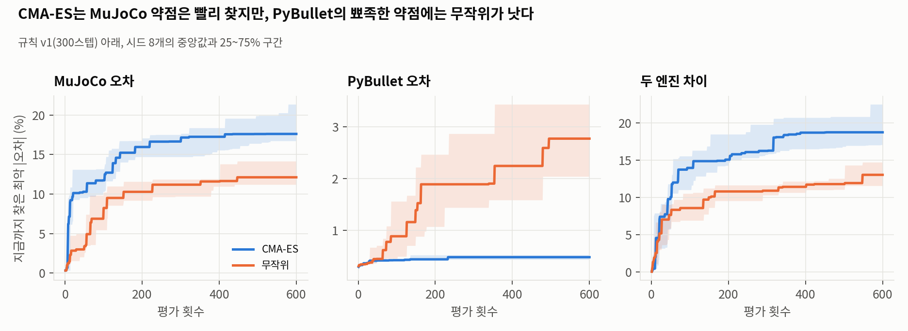

- MuJoCo의 약점은 매끄러운 언덕 모양이라 CMA-ES가 강했다. 평가의 63%가 1% 넘는 반례였다 (무작위 6%). 600회 뒤 찾은 최악값 중앙값 17.6% vs 12.1%.
- PyBullet의 약점은 뾰족한 바늘 모양이라 **CMA-ES가 완전히 실패**했다 (최악값 중앙값 0.48% vs 무작위 2.77%).
- 이유를 확인해 보니, PyBullet 최악 조건에서는 **입력을 1e-12만 바꿔도 결과가 5%에서 23%까지 요동쳤다** (200회, 중앙값 7.1%). 평범한 조건에서는 같은 흔들림에 결과 차이가 1e-13% 수준이었다. 이 영역에서 PyBullet 결과는 사실상 무작위 값이다. 실행 자체는 결정적이어서, 같은 입력을 넣으면 항상 같은 값이 나온다.
- 교훈: 퍼징은 한 가지 탐색기로 끝내면 안 된다. 매끄러운 약점과 뾰족한 약점을 둘 다 잡으려면 진화 전략과 무작위 탐색을 섞어야 한다.

---

# 3단계-B: 불일치 지도 — 정답 없이 오차를 추정할 수 있을까

실제 연구에서는 정답(해석해)이 없다. 그래서 정답 없이 계산할 수 있는 두 가지 신호가 실제 오차를 얼마나 맞히는지 비교했다.

- **엔진 간 불일치**: 같은 조건을 MuJoCo와 PyBullet으로 돌린 결과 차이
- **자기 불일치**: 같은 엔진을 dt와 dt/2로 돌린 결과 차이. 1차 정확도 방법에서는 이론상 오차 ≈ 2 x 자기 불일치 (리처드슨 추정)

상자 무작위 조건 1,500개, 2링크 팔 초기자세 15개 x 타임스텝 4개 x 시점 3개(180개)로 측정했다.

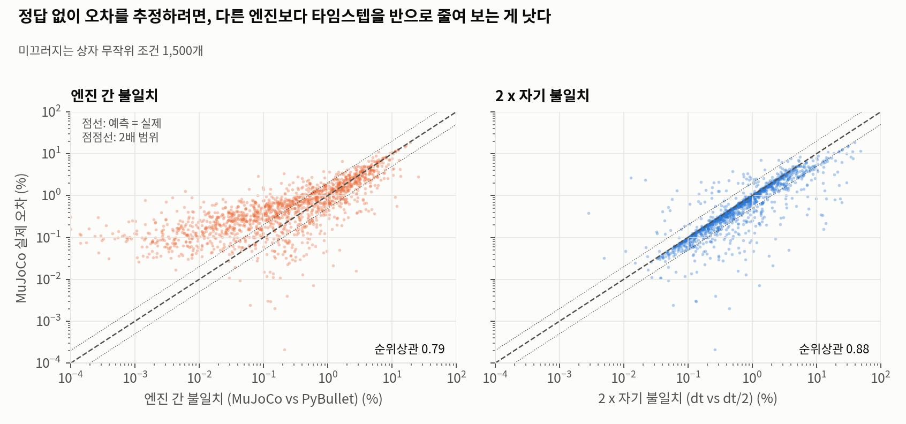

| | 순위상관 | 실패 골라내기 AUC | 크기가 실제의 0.5~2배 안 |
|---|---|---|---|
| 상자, MuJoCo 오차 ← 엔진 간 불일치 | 0.79 | 0.94 | 41% |
| 상자, MuJoCo 오차 ← 자기 불일치 | **0.88** | **0.95** | **82%** |
| 상자, PyBullet 오차 ← 엔진 간 불일치 | 0.57 | 0.86 | 27% |
| 상자, PyBullet 오차 ← 자기 불일치 | **0.67** | **0.92** | **69%** |
| 2링크 팔 ← 엔진 간 불일치 | 0.78 | 0.93 | 0% (10¹³배 과소) |
| 2링크 팔 ← 자기 불일치 | **0.999** | **1.00** | **97%** (오차/예측 중앙값 1.00) |

- 모든 경우에서 **자기 불일치가 엔진 간 불일치보다 나았다.**
- 2링크 팔에서 두 엔진의 차이는 중앙값 2 x 10⁻¹⁵ rad인데 실제 오차는 0.03 rad다. 순위는 어느 정도 맞지만 크기는 쓸모가 없다. 같은 적분 방식을 쓰는 두 엔진은 서로의 오차를 볼 수 없다.
- 자기 불일치 x 2 는 2링크 팔에서 실제 오차를 거의 정확히 맞혔다 (비율 중앙값 1.00).
- 비용도 싸다. 다른 엔진으로 장면을 다시 만들 필요 없이, dt/2로 한 번 더 돌리면 된다 (계산량 3배).

## 3단계 한계

- 최종 규칙은 "미끄러지다 멈추는 상자" 한 종류의 접촉에서 나왔다. 충돌(반발), 여러 점 접촉(잡기), 굴러가는 물체에서는 다시 퍼징해야 한다.
- 퍼징은 반례가 "없다"는 증명이 아니다. 규칙 v3 아래 목표당 9,600회 평가에서 최악 2%였다는 뜻이다.
- 불일치 지도의 "자기 불일치"는 오차가 dt에 비례할 때 잘 맞는다. PyBullet의 혼돈적 접촉 영역처럼 결과가 입력에 대해 불연속이면 어떤 추정도 믿기 어렵다.

## 다음 단계

1. **실물 검증**: 진자나 서보 1개를 웹캠으로 찍어, "자기 불일치로 추정한 시뮬 오차"와 "실측과의 차이"를 비교. 시뮬 자체의 오차와 모델링 오차(sim-to-real 갭)를 분리할 수 있다.
2. **다른 접촉 장면으로 확장**: 공 튕기기, 그리퍼 잡기에서 퍼징 → 규칙 보완을 반복.
3. **도구화**: `simdiff check` — 시뮬 설정을 넣으면 규칙 위반과 자기 불일치를 자동으로 보고.
4. **LLM이 만든 시뮬 코드 감사**: 이번에 찾은 함정과 규칙을 LLM 생성 코드가 얼마나 어기는지 측정.

## 파일 구조

```
simdiff/
├── simdiff/scenes/pendulum.py       진자 (기준 해, MJCF, URDF)
├── simdiff/scenes/two_link_arm.py   2링크 팔 (라그랑주 운동방정식 기준 해, MJCF, URDF)
├── simdiff/scenes/sliding_box.py    미끄러지는 상자 (해석해, 두 엔진 실행기, 상자 높이 조절)
├── simdiff/engines.py               엔진 실행기, PyBullet 기본값 진단
├── experiments/                     pendulum_sweep.yaml, arm_sweep.yaml
├── run_pendulum.py / analyze.py     1단계
├── run_arm.py / run_box.py / run_sobol.py / analyze_stage2.py   2단계
├── fuzz.py                          3단계 퍼징 (규칙 버전 v1, v1_mu, v2, v3)
├── scan_contact.py                  넘어짐 여유 격자
├── pb_chaos.py                      PyBullet 입력 민감도
├── failure_tree.py                  실패 원인 의사결정나무
├── disagreement_map.py              불일치 지도
├── analyze_stage3.py                3단계 요약·그래프
├── analyze_style.py                 그래프 공통 스타일
├── results/                         CSV, 요약 JSON(summary*.json), Sobol 표본, 퍼징 기록
└── figures/                         그래프 11장
```

실행 환경: MuJoCo 3.14.0, PyBullet (2025-01 빌드), SciPy 1.17.1, SALib, cma 4.5.0, scikit-learn 1.8.0 — 자세한 값은 `results/env.json`.

재현 메모: 퍼징 기록 CSV에서 입력값을 다시 읽을 때는 `pd.read_csv(..., float_precision="round_trip")`을 써야 한다.
PyBullet의 혼돈적 접촉 영역에서는 마지막 자리 반올림 차이만으로도 결과가 달라진다.
